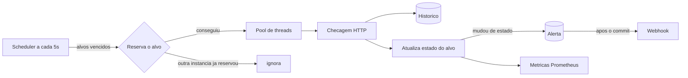

# Monitor de saude de servicos

Servico que checa URLs de tempos em tempos, guarda o historico, abre alertas quando um servico cai ou volta e expoe metricas para o Prometheus. Tambem tem a propria saude monitorada pelo Actuator.

Stack: Java 17, Spring Boot 3.5, Spring Data JPA, PostgreSQL, Flyway, Actuator, Micrometer (Prometheus), Testcontainers, Docker Compose.

## Como funciona



1. Cada **alvo** tem URL, metodo (`GET`/`HEAD`), intervalo, timeout, status esperado, texto opcional que o corpo deve conter e quantas falhas seguidas contam como queda.
2. A cada 5 segundos o scheduler procura alvos com a checagem vencida, **reserva** cada um e dispara a checagem em um pool de threads (varios alvos sao checados em paralelo).
3. O resultado vai para o **historico** (status HTTP, latencia, erro).
4. O estado do alvo muda e, so quando muda, nasce um **alerta**.

### Estados e alertas

| Estado | Significado |
|---|---|
| `UNKNOWN` | Ainda nao foi checado. |
| `UP` | Ultima checagem passou. |
| `DOWN` | Falhou `failureThreshold` vezes seguidas. |

- Uma falha isolada nao alerta: o alvo so vira `DOWN` depois de N falhas **seguidas** (padrao 3).
- Alerta so existe na **mudanca** de estado: `DOWN` ao cair e `RECOVERED` ao voltar. Continuar fora do ar nao gera um alerta a cada checagem.
- Volta para `UP` na primeira checagem bem-sucedida.

### O que conta como falha

Status diferente do esperado, corpo sem o texto esperado, timeout, conexao recusada, host que nao resolve. Nenhum erro de rede estoura excecao: tudo vira um resultado `success: false` com a mensagem do motivo (`Status 503 (esperado 200)`, `Timeout apos 5000ms`, `Conexao recusada ou host inacessivel`).

### Alertas por webhook

Com `ALERT_WEBHOOK_URL` configurada, cada alerta e enviado por `POST` em JSON:

```json
{
  "type": "DOWN",
  "target": "api-pagamentos",
  "url": "https://api.exemplo.com/health",
  "message": "api-pagamentos esta fora do ar: 3 falhas seguidas (ultimo erro: Status 503 (esperado 200))",
  "occurredAt": "2026-03-01T12:00:00Z"
}
```

- O envio so acontece **depois do commit** do alerta (nunca se avisa de algo que nao foi gravado) e em transacao propria.
- Se o webhook estiver fora do ar, o alerta fica pendente (`notifiedAt` vazio), a falha e registrada em `lastNotifyError` e um job reenvia a cada minuto, ate 5 tentativas.
- Falha na entrega do alerta nunca atrapalha a checagem nem o historico.
- Sem webhook configurada, o alerta aparece so na API e no log.

## Decisoes que valem explicar

**Reserva do alvo (sem checagem duplicada).** O scheduler "reserva" o alvo com um unico `UPDATE ... SET next_check_at = agora + intervalo WHERE next_check_at <= agora`. Se duas instancias do monitor (ou dois ticks sobrepostos) disputarem o mesmo alvo, so uma recebe `1` linha afetada e checa. A coluna `next_check_at` e `updatable = false` na entidade: o `save()` do fim da checagem nunca desfaz a reserva feita por outra instancia.

**A chamada HTTP fica fora de transacao.** Uma checagem pode ficar presa ate o timeout. A requisicao roda sem transacao aberta e so a gravacao do resultado abre uma, entao conexoes do banco nao ficam presas esperando a rede.

**Falha de um alvo nao afeta os outros.** Cada checagem roda isolada: excecao em um alvo e logada e as demais seguem.

**Latencia so das checagens bem-sucedidas.** Um timeout de 5s nao e "latencia do servico". As estatisticas (`avg` e `p95`, via `percentile_cont`) e o timer do Prometheus ignoram as falhas; o uptime considera todas.

**Historico com retencao.** Um job diario (03:30) apaga resultados mais antigos que `monitor.history.retention-days` (30 por padrao). Sem isso a tabela so cresce.

**Health que detecta scheduler parado.** `/actuator/health` tem o componente `monitor`: fica `DOWN` se o scheduler deixou de rodar (um monitor "no ar" que nao checa nada e pior do que um monitor fora do ar). Servicos monitorados que estao `DOWN` **nao** derrubam o health do monitor: ele esta saudavel, quem caiu foi o outro.

## Rodando

Precisa de Java 17, Maven e Docker.

```bash
docker compose up --build -d
./scripts/smoke-test.sh      # usa o scheduler de verdade, leva cerca de 1 minuto
```

### Exemplo

```bash
# cadastra um alvo (so name e url sao obrigatorios)
curl -X POST localhost:8085/targets -H 'Content-Type: application/json' -d '{
  "name": "api-pagamentos",
  "url": "https://api.exemplo.com/health",
  "intervalSeconds": 30,
  "timeoutMs": 3000,
  "expectedStatus": 200,
  "expectedBodyContains": "UP",
  "failureThreshold": 3
}'

curl localhost:8085/targets                      # lista com o estado atual
curl localhost:8085/targets/<id>/history         # historico paginado
curl localhost:8085/targets/<id>/stats?hours=24  # uptime e latencia
curl localhost:8085/alerts                       # todos os alertas
curl -X POST localhost:8085/targets/<id>/check   # checa agora
```

### Endpoints

| Metodo | Rota | Descricao |
|---|---|---|
| POST / GET | `/targets` | Cria / lista alvos |
| GET / PUT / DELETE | `/targets/{id}` | Detalhe / edita (inclui `active`) / apaga com historico e alertas |
| POST | `/targets/{id}/check` | Checa agora e devolve o resultado |
| POST | `/targets/{id}/pause` | Pausa o monitoramento (o historico, o estado e os alertas ficam como estao). Pausar duas vezes nao e erro |
| POST | `/targets/{id}/resume` | Retoma e agenda uma checagem imediata |
| GET | `/status` | Situacao geral e de cada servico ativo (sem expor as URLs). Tem uma pagina pronta em `/status.html` |
| GET | `/targets/{id}/history?failuresOnly=&page=&size=` | Historico, mais recente primeiro |
| GET | `/targets/{id}/stats?hours=24` | Total de checagens, uptime %, latencia media e p95 |
| GET | `/alerts?targetId=` | Alertas com situacao da entrega do webhook |
| GET | `/actuator/health` | Saude do monitor, do banco e do scheduler |
| GET | `/actuator/metrics` | Metricas Micrometer |
| GET | `/actuator/prometheus` | Metricas no formato Prometheus |

### Pagina de status

`GET /status` devolve a situacao geral (`OPERATIONAL`, `DEGRADED`, `MAJOR_OUTAGE` ou `NO_DATA`) e, para cada servico **ativo**, o estado atual, a ultima checagem e o uptime das ultimas 24h. Alvos pausados nao aparecem nem pesam na situacao geral, e alvos que ainda nao foram checados ficam de fora da conta. A URL monitorada nunca aparece (pode ser um endereco interno). `GET /status.html` e uma pagina simples, sem framework, que consome esse endpoint e se atualiza a cada 30 segundos.

### Metricas

| Metrica | Tipo | Descricao |
|---|---|---|
| `monitor_target_up{target}` | gauge | 1 = UP, 0 = DOWN |
| `monitor_checks_total{target,result}` | counter | Checagens por resultado (`success`/`failure`) |
| `monitor_check_latency_seconds{target}` | timer | Tempo de resposta das checagens bem-sucedidas |
| `monitor_targets_down` | gauge | Quantos alvos ativos estao fora do ar agora |

Exemplo de regra de alerta no Prometheus: `monitor_target_up == 0`.

## Variaveis de ambiente

| Variavel | Padrao | Para que serve |
|---|---|---|
| `DB_URL` | monta a partir das tres abaixo | URL JDBC completa (se definida, ignora `DB_HOST`, `DB_PORT` e `DB_NAME`) |
| `DB_HOST` / `DB_PORT` / `DB_NAME` | `localhost` / `5437` / `monitor` | Onde esta o Postgres |
| `DB_USER` / `DB_PASSWORD` | `monitor` / `monitor` | Credenciais do banco |
| `ALERT_WEBHOOK_URL` | vazio | Se preenchida, cada alerta vira um `POST` em JSON nessa URL; vazia, os alertas ficam so na API e no log |

## Deploy

Existe um `render.yaml` (Blueprint do Render) com a API em Docker e um Postgres gratuito, mas **ainda nao publiquei nem testei no Render**, entao nao ha link de demo. O banco gratuito do Render expira depois de um tempo, serve para demonstracao. Em hospedagem gratuita que "dorme" por inatividade, o monitor tambem para de checar enquanto dorme.

## Dashboard Grafana

O arquivo [`grafana/dashboard.json`](grafana/dashboard.json) e um dashboard de exemplo com 8 paineis: servicos fora do ar, situacao de cada servico ao longo do tempo, tempo de resposta medio e maximo, falhas por minuto e disponibilidade na janela. Para usar: configurar o Prometheus para coletar `/actuator/prometheus` e, no Grafana, `Dashboards > Import` apontando para o arquivo. **Eu gerei o JSON e validei a sintaxe, mas ainda nao importei num Grafana de verdade**, entao algum painel pode precisar de ajuste.

## Testes

```bash
mvn verify
```

98 testes. Os de integracao usam Testcontainers (Postgres real) e servidores HTTP locais que fazem o papel do servico monitorado e do webhook, entao o Docker precisa estar rodando.

- **Regra de estado**: threshold de falhas seguidas, falha isolada nao alerta, continuar `DOWN` nao repete alerta, recuperacao.
- **Checagem HTTP**: status esperado, texto no corpo, `HEAD`, timeout, conexao recusada, host inexistente.
- **Alertas**: so na mudanca de estado, payload do webhook, webhook fora do ar deixa pendente e o retry entrega, para de tentar apos 5, webhook inalcancavel nao quebra a checagem.
- **Scheduler**: so checa alvos vencidos e ativos, proximo horario calculado, reserva vence uma vez so mesmo com 8 threads, 4 ticks simultaneos checam cada alvo uma vez, alvo quebrado nao impede os outros, retencao do historico.
- **API**: validacoes (400/409/422), valores padrao, edicao/renomeacao, exclusao em cascata, paginacao, estatisticas (uptime, media e p95).
- **Actuator e metricas**: health com componente `monitor` e banco, gauges/counters/timer no Prometheus, series removidas ao apagar ou renomear um alvo.
- **Health do scheduler**: parado, recente, ainda sem tick, desligado.

## Limitacoes conhecidas

- **Sem autenticacao**: qualquer um com acesso a API cadastra, pausa e apaga alvos. Como o monitor faz requisicoes para as URLs cadastradas, em producao a API precisa ficar atras de autenticacao. A pagina `/status` e publica de proposito, mas mostra so nomes e estados.
- **SSRF**: so `http`/`https` sao aceitos, mas enderecos internos (como o metadata de nuvem `169.254.169.254`) nao sao bloqueados. Uma allowlist de hosts seria o proximo passo.
- **Leitura do corpo sem limite de tempo**: o timeout cobre a conexao e os headers; um servidor que responde os headers e depois entrega o corpo a conta-gotas pode prender uma thread do pool.
- **Alertas so por webhook**: sem e-mail e sem escalonamento. Para manutencao da para pausar o alvo na mao (`/pause`), mas nao existe janela de manutencao agendada.
- **Pagina de status simples**: mostra so o estado atual e o uptime de 24h, sem historico de incidentes.
- **Checagens com o mesmo intervalo e ao mesmo tempo**: o pool tem 8 threads. Com centenas de alvos de intervalo curto, as checagens podem atrasar na fila.
- **Sem checagem de certificado TLS proximo do vencimento**.
- **Reserva e por alvo, nao por instancia**: se uma instancia morrer no meio de uma checagem, aquele alvo so e checado de novo no proximo intervalo.
- **Dashboard Grafana nao testado** num Grafana de verdade (so a sintaxe do JSON foi validada).
